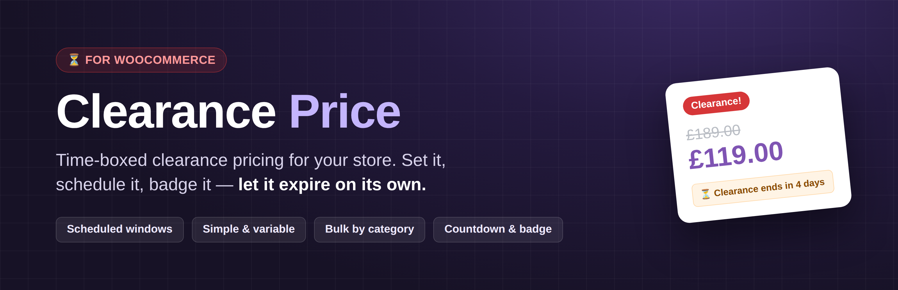
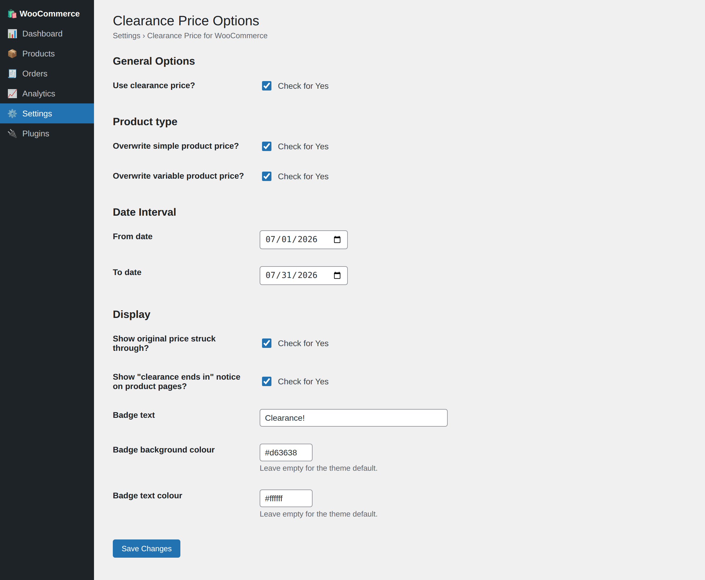
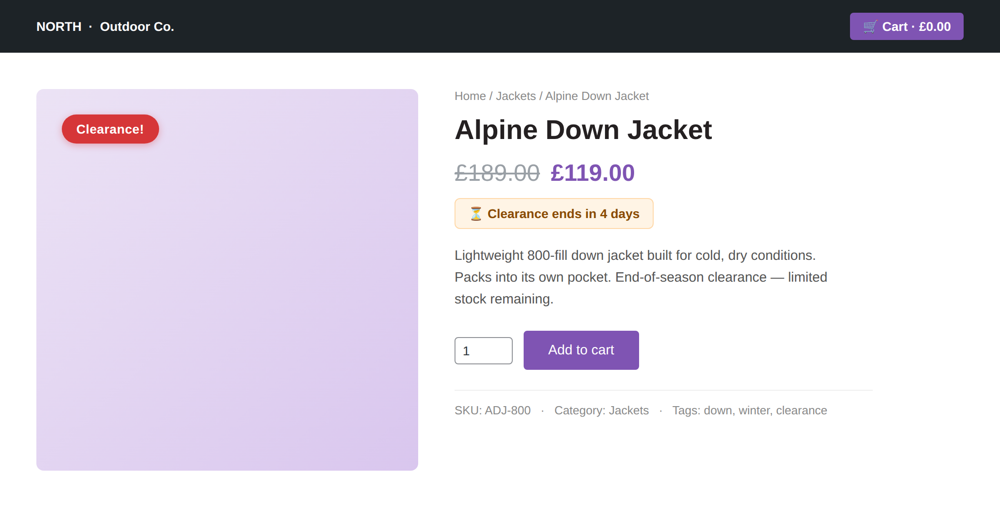
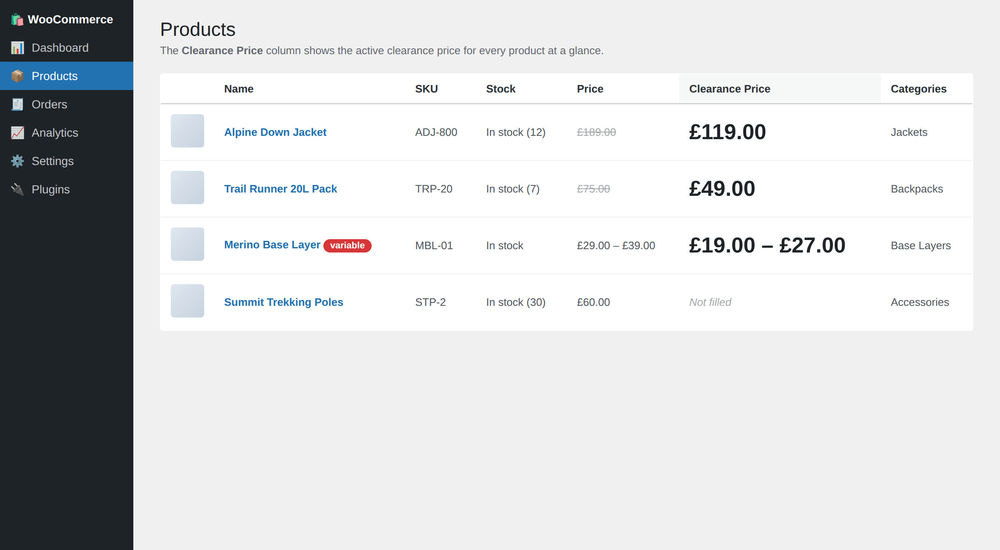
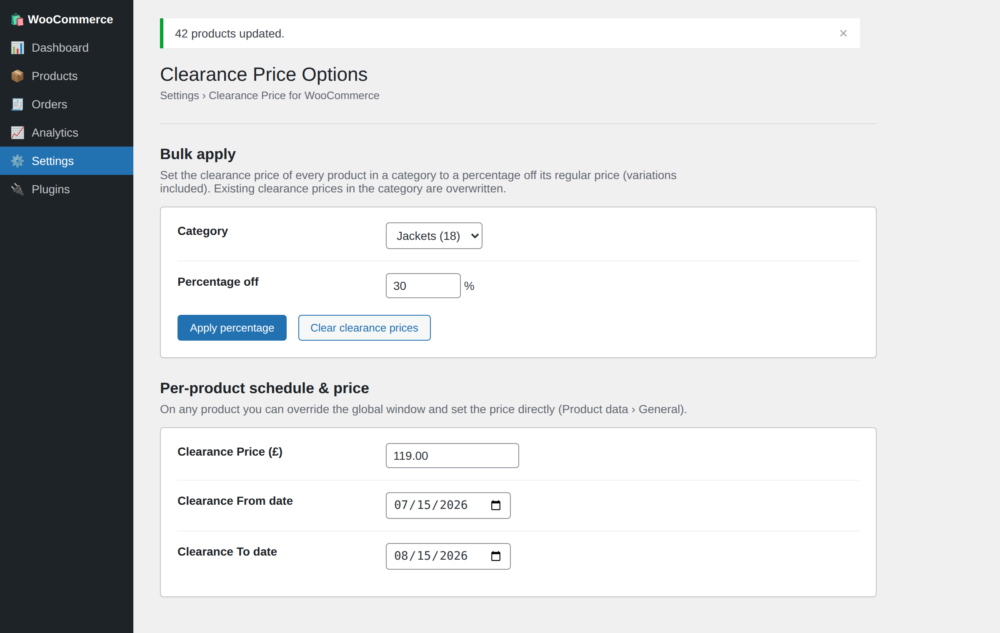

<p align="center">
  
</p>

<h1 align="center">Clearance Price for WooCommerce</h1>

<p align="center">
  <strong>Set it. Schedule it. Badge it. Let it expire on its own.</strong>
</p>

<p align="center">
  
  
  
  
  
</p>

---

## Why Clearance Price exists

WooCommerce's built-in **sale price** is one field with an on/off schedule per product. That's fine for a single promo, but it falls short of a real clearance:

- **"Run the clearance for July, then put prices back."** You want one date window that governs the whole store — not a schedule you set and unset on every product.
- **"Mark down the whole Jackets category by 30%."** You don't want to open forty products and type forty numbers.
- **"Make it obvious, and make it end."** Shoppers should see the old price crossed out, a *Clearance!* badge, and how long they've got left — and the markdown should switch itself off when the window closes.

Clearance Price keeps a **second price** on every product that only takes over during a window you control — globally, or per product — and gives it the display treatment a clearance deserves.

## What the plugin includes

- 🏷️ **A dedicated clearance price** on simple products and on each variation of variable products — stored separately from the regular and sale price, so nothing you already sell is disturbed.
- 🗓️ **A global clearance window** with From / To dates, evaluated in your site's timezone, with the end day fully included. Leave a date empty for an open-ended window.
- 📌 **Per-product schedules** that override the global window on any product (variations follow their parent).
- 🧮 **Bulk apply by category** — set every product in a category to a percentage off its regular price (variations included), or clear a category's clearance prices, in one action.
- ➖ **Struck-through original price** on the shop and product pages, sale-style, so the saving is visible.
- 🔻 **Variable-product ranges** — variable products show a clearance-aware price range instead of a blanked-out price.
- 🔖 **A customisable badge** — your own text and colours; clearance products are treated as on sale so the badge shows even without a WooCommerce sale price.
- ⏳ **A countdown notice** on product pages ("Clearance ends in 4 days") whenever the active window has an end date.
- 🧾 **Order analytics hook** — the applied clearance price is written to each order line item (`_clearance_price_applied`) so clearance revenue can be reported.
- 🔢 **A `[clearance_products]` shortcode** that lists everything currently on clearance.
- 📊 **An admin column** showing the active clearance price for every product at a glance.
- 🔒 **Written to WordPress standards** — output escaped, prices sanitised with WooCommerce's own helpers, capability + nonce checks on every write, HPOS-compatible, and covered by unit tests in CI.

## ⚡ Quick start

1. Install and activate the plugin (WooCommerce must be active).
2. Go to **Settings → Clearance Price for WooCommerce**, tick **Use clearance price?**, choose the product types, and set your **From / To** dates.
3. Edit a product and fill in the **Clearance Price** field (General tab for simple products; on each variation for variable products) — or use **Bulk apply** on the settings page to mark down a whole category at once.

That's it. During the window, the clearance price takes over the cart and the storefront, the badge and countdown appear, and when the window ends everything reverts on its own.

## Screenshots

| Settings | Storefront |
|---|---|
|  |  |

| Product list | Bulk apply & per-product schedule |
|---|---|
|  |  |

## Shortcode

`[clearance_products]` renders the products whose clearance price is currently active, through WooCommerce's own product grid.

| Attribute | Default | Description |
|---|---|---|
| `limit` | `12` | Maximum number of products to show |
| `columns` | `4` | Grid columns |
| `orderby` | `title` | Any orderby WooCommerce's `[products]` accepts (`title`, `date`, `price`, `menu_order`, …) |
| `order` | `ASC` | `ASC` or `DESC` |

```
[clearance_products limit="8" columns="4" orderby="price" order="ASC"]
```

## How the window is evaluated

Dates are compared in your site's timezone (`wp_timezone()`), and the **To** day is fully included — a window ending `2026-07-31` stays active until `23:59:59` on the 31st. An empty **From** means "active immediately"; an empty **To** means "no end". A per-product schedule (`_clearance_price_from` / `_clearance_price_to`) replaces the global window for that product whenever either of its dates is set; otherwise the product falls back to the global dates.

## Development

Install the dev tooling and run the checks:

```bash
composer install
composer lint     # PHP syntax check across the codebase
composer phpcs    # WordPress-Extra + PHPCompatibilityWP coding standards
composer phpstan  # static analysis (level 5, WordPress/WooCommerce stubs)
composer test     # PHPUnit unit tests (date window, price/date/colour sanitisers)
composer check    # all of the above
```

The same checks run in GitHub Actions on every push and pull request (lint on PHP 7.4–8.3).

### Code structure

| Path | Responsibility |
|---|---|
| `clearance.php` | Bootstrap: headers, constants, PHP guard, HPOS declaration, `plugins_loaded` wiring |
| `includes/class-clearance-price-options.php` | Shared toggles, clearance-window resolution and price validation |
| `includes/class-clearance-price-settings.php` | Settings page, registration, sanitisers and admin assets |
| `includes/class-clearance-price-product-meta.php` | Clearance price + schedule fields on the product editor |
| `includes/class-clearance-price-price-manager.php` | Cart override, displayed prices, badge, countdown, order-item meta |
| `includes/class-clearance-price-admin-columns.php` | "Clearance Price" column in the product list |
| `includes/class-clearance-price-bulk.php` | Bulk apply / clear clearance prices by category |
| `includes/class-clearance-price-shortcode.php` | `[clearance_products]` |
| `uninstall.php` | Removes plugin options on delete |

### Useful hooks

| Hook | Type | Purpose |
|---|---|---|
| `clearance_price_window_active` | filter | Override whether the clearance window is active for a product (`$active`, `$product_id`) |
| `clearance_price_badge_html` | filter | Customise the clearance badge markup (`$html`, `$product`) |
| `clearance_price_settings_after_form` | action | Render extra UI after the settings form (the bulk tool uses this) |

### Data the plugin stores

| Key | Location | Meaning |
|---|---|---|
| `_clearance_price` | product / variation meta | The clearance price |
| `_clearance_price_from` / `_clearance_price_to` | product meta | Optional per-product schedule |
| `_clearance_price_applied` | order line-item meta | Clearance price applied at checkout, for reporting |
| `clearance_price_*` | options | Settings (master switch, product types, dates, display, badge) |

Uninstalling removes the options. Product and order meta are intentionally kept so data survives a reinstall — remove them manually for a full cleanup.

## License

GPL-2.0-or-later. See [LICENSE](https://www.gnu.org/licenses/gpl-2.0.html).

---

<p align="center">
  Built and maintained by <a href="https://nomad-developer.co.uk/">Costin Botez</a> — <a href="https://nomad-developer.co.uk/">Nomad Developer</a><br />
  WordPress and WooCommerce development for agencies and small businesses.<br />
  If this plugin is useful, you can <a href="https://buymeacoffee.com/costinbotez">buy me a coffee</a> ☕
</p>
